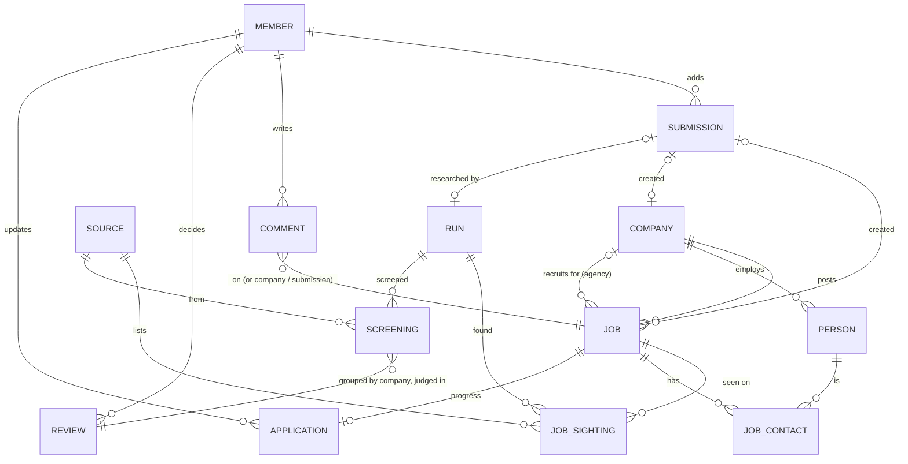

# Design with Purpose: data model

The logical data model for the whole project: what we store, how the pieces relate, who writes what, and who can see it. It's written so the database schema (Firestore) can be designed directly from it. `data/SCHEMA.md` stays as the file format the research agents write today; this document is the target.

## Principles

1. **Store facts, calculate opinions.** Match score, tier, region and company type are calculated from stored facts and the scoring settings. They are never typed in, so changing a weight re-ranks everything.
2. **Two kinds of writer.**
   - *Pipeline*: scripts and research agents (company careers feeds, job-board sweeps, LinkedIn passes, submission research). They write companies, jobs, people, sources, runs and screenings.
   - *Members*: Robyn and Matthew. They write progress, comments, reviews, submissions and overrides.
   - Neither overwrites the other's fields. A human correction is stored as an **override** next to the pipeline value, so the next refresh doesn't undo it.
3. **Nothing is silently dropped.** Every posting a sweep looks at becomes either a job or a **screening** record with a written reason, so a person can check it.
4. **Every record says where it came from and when** (`source`, `run_id`, `checked_at`), so "how deep did we search?" can always be answered.
5. **Only two people sign in.** Access is an allow-list of two Google accounts, enforced in the database rules (see [Access](#access)).

## Entities at a glance



| Entity | What it is | Written by | Count today |
|---|---|---|---|
| **Company** | Any employer: the 130 researched register companies, plus employers found through job adverts | Pipeline (+ member overrides) | 130 + ~120 |
| **Job** | One open role (a posting in several cities counts as one job) | Pipeline (+ member overrides) | 154 |
| **Job sighting** | Where and when a job was seen (one job, many boards) | Pipeline | ~220 |
| **Person** | A named contact at a company, with their LinkedIn profile | Pipeline | ~200 |
| **Job contact** | A person linked to a specific job (hiring team, recruiter) | Pipeline | ~25 |
| **Source** | A job board, feed, community or careers system we use | Pipeline | 91 |
| **Run** | One research pass: a feed fetch, a sweep, a LinkedIn pass or a submission | Pipeline | — (new) |
| **Screening** | A posting a run looked at, with its outcome and reason (added, or passed on) | Pipeline | 329 passed |
| **Review** | A member's decision on a passed-on company | Members | — |
| **Application** | Robyn's progress on a job (Shortlisted, Applied…) | Members | — |
| **Comment** | A note or discussion on a job, company or submission | Members | — |
| **Submission** | A link Robyn or Matthew added for the app to research | Members create, pipeline completes | — (new) |
| **Member** | One of the two people allowed in | Admin (set once) | 2 |
| **Settings** | Scoring weights, tiers, regions, title filters, top product list | Members (Matthew) | 1 |

## Entities in detail

Types: `string`, `int`, `bool`, `date` (YYYY-MM-DD), `timestamp`, `url`, `enum`, `ref(Entity)`, `[]` = list, `?` = optional.

### Company

| Field | Type | Notes |
|---|---|---|
| `id` | string | Stable slug, e.g. `octopus-energy` |
| `name` | string | Display name |
| `aliases` | string[] | Other spellings seen in adverts ("HM Revenue & Customs" → HMRC). Used to merge duplicates. |
| `website` | url? | |
| `careers_url` | url? | Human careers page |
| `ats` | { `provider` enum, `slug` string, `api_url` url? }? | The company's hiring system, e.g. Greenhouse, Ashby, Workable. `api_url` makes its jobs automatic. |
| `linkedin_url` | url? | Exact company page, never a search link |
| `linkedin_check` | { `method` enum(website-footer, job-post, search+http200), `confidence` enum(high, medium), `checked_at` timestamp, `note` string? } | How we know the LinkedIn page is right |
| `sectors` | enum[] | See [Sectors](#enumerations) |
| `org_type` | enum | charity, social-enterprise, b-corp, startup, scaleup, corporate, public-sector |
| `hq` | string? | |
| `uk_presence` | string? | Offices and remote policy, free text |
| `size_band` | string? | e.g. `201-500` |
| `mission` | string? | One sentence |
| `purpose_score` | int 1–5 | Pipeline's assessment |
| `purpose_rationale` | string | **Required.** Why that score |
| `purpose_source` | enum | register, sweep, submission, human |
| `top_product` | bool | On the top product list (see Settings) |
| `design_team_notes` | string? | |
| `in_register` | bool | Researched in depth and monitored on every refresh |
| `feed` | { `status` enum(ok, empty, error, none), `last_fetched` timestamp, `error` string? }? | Health of its careers feed |
| `status` | enum | active, merged, defunct |
| `merged_into` | ref(Company)? | When duplicates are merged |
| `overrides` | { field → { `value`, `by` ref(Member), `at` timestamp, `note` string? } } | Member corrections, e.g. a different purpose score. Overrides win over pipeline values. |
| `created_at`, `updated_at` | timestamp | |
| `created_by` | enum(pipeline) or ref(Member) | |
| `run_id` | ref(Run)? | Last run that updated it |

### Job

| Field | Type | Notes |
|---|---|---|
| `id` | string | Slug of company + title, stable across refreshes |
| `company_id` | ref(Company) | The employer. For an agency post with an unnamed client, a placeholder company. |
| `recruiter_company_id` | ref(Company)? | The agency, when a recruiter posted it |
| `client_unnamed` | bool | Recruiter didn't name the employer |
| `title` | string | As advertised |
| `title_normalised` | string | Used for de-duplication |
| `apply_url` | url | The employer's own posting where possible |
| `locations` | string[] | One job can list several cities |
| `work_model` | enum | remote, hybrid, office, unknown |
| `office_days` | int 0–5? | Office days a week, from the advert |
| `seniority` | enum | junior, mid, senior, lead, unknown |
| `years_experience` | { `min` int?, `text` string? } | e.g. min 3, "3+ years" |
| `employment_type` | enum? | permanent, fixed-term, contract, freelance |
| `salary` | { `text` string, `min` int?, `max` int?, `currency` string?, `period` enum(year, day, hour)? }? | |
| `posted_on` | date? | |
| `closes_on` | date? | |
| `role_summary` | string | 2–3 sentences in our own words |
| `applicants_text` | string? | e.g. "Over 200 applicants" |
| `sectors` | enum[]? | Only if different from the company's |
| `purpose_score` | int 1–5? | Only if the role differs from the company, e.g. Google's health team |
| `status` | enum | open, unconfirmed (seen, but the live posting couldn't be opened), closed, expired (past closing date) |
| `verified_open_at` | timestamp? | Last time the live posting was opened |
| `first_seen_at`, `last_seen_at` | timestamp | Drives the "New" badge |
| `added_via` | enum | feed, sweep, linkedin, submission, manual |
| `submission_id` | ref(Submission)? | If a member added it |
| `overrides` | as Company | e.g. correct the seniority or office days |
| `run_id` | ref(Run) | |

**Calculated, never stored as truth** (calculated by the build from facts plus Settings, and cached on the job for fast display):

| Field | How |
|---|---|
| `region` | From `locations`: London, South East, South West, East, Midlands, North, Remote UK, Non-UK |
| `work_rule` | From work model, office days and region (see Scoring tab) |
| `company_kind` | top (top product company), purpose (purpose ≥ 3), other |
| `score_parts` | `{purpose 0–40, work 0–30, level 0–30}` |
| `match`, `tier` | Sum of `score_parts`; strong ≥ 80, good ≥ 62, else stretch |

### Job sighting

| Field | Type | Notes |
|---|---|---|
| `job_id` | ref(Job) | |
| `source_id` | ref(Source) | |
| `url` | url | The listing on that source |
| `external_id` | string? | e.g. LinkedIn job id, Greenhouse id |
| `seen_at` | timestamp | |
| `run_id` | ref(Run) | |

### Person

| Field | Type | Notes |
|---|---|---|
| `id` | string | LinkedIn slug where known |
| `name` | string | |
| `headline` | string | Their LinkedIn headline or job title |
| `linkedin_url` | url? | Profile URL |
| `company_id` | ref(Company) | Current employer |
| `role` | enum | head-of-design, design-lead, head-of-product, product-designer, recruiter, hiring-manager |
| `verified` | bool | True when their current employer was confirmed (company People tab) |
| `verification_note` | string? | e.g. "Headline doesn't name the company" |
| `found_via` | enum | people-tab, hiring-team, job-advert, web-search |
| `found_at` | timestamp | |
| `run_id` | ref(Run) | |

### Job contact

| Field | Type | Notes |
|---|---|---|
| `job_id` | ref(Job) | |
| `person_id` | ref(Person) | |
| `relation` | enum | hiring-manager, recruiter, job-poster, named-in-advert |
| `source` | enum | linkedin-hiring-team, job-advert |

### Source

| Field | Type | Notes |
|---|---|---|
| `id`, `name`, `url`, `search_url?` | | |
| `kind` | enum | climate-board, charity-board, impact-board, design-board, general-board, investor-board, public-sector, community, company-careers |
| `how` | enum | auto (feed read every refresh), sweep (Claude reads public pages on request), feed (feed exists, not connected), alert (blocked or login-only; Robyn sets an email alert), join (community or newsletter), retired |
| `api_endpoint` | url? | |
| `relevance` | int 1–5 | Fit for Robyn |
| `uk_coverage` | bool | |
| `status` | enum | active, inactive, no-jobs-board, not-found |
| `notes` | string | Plain language, including coverage of the last pass |
| `last_checked` | timestamp | |
| *calculated:* `roles_on_board` | int | Jobs with a sighting from this source |

### Run

One row per research pass, so coverage is always on record.

| Field | Type | Notes |
|---|---|---|
| `id` | string | |
| `kind` | enum | ats-fetch, boards-fetch, aggregator-sweep, linkedin-public, linkedin-logged-in, people-search, company-linkedin, submission-research, junior-sweep |
| `started_at`, `finished_at` | timestamp | |
| `params` | object | e.g. `{query, filters, lookback_days: 30, location: "UK"}` |
| `stats` | object | e.g. `{results_reported: 413, reviewed: 413, already_on_board: 56, added: 22, passed: {commercial: 306, …}, page_loads: 39}` |
| `limits_hit` | string? | Rate limits, bot checks |
| `model`, `cost_usd` | string?, number? | For Claude-run research |
| `triggered_by` | enum(schedule, member, manual) | |
| `submission_id` | ref(Submission)? | |

### Screening

Every posting a run looked at and didn't turn into a job. This is the Passed on tab.

| Field | Type | Notes |
|---|---|---|
| `id` | string | Run + external id |
| `run_id` | ref(Run) | |
| `source_id` | ref(Source) | |
| `external_id`, `url` | string, url | The advert |
| `title`, `company_name`, `location` | string | As seen |
| `company_id` | ref(Company)? | If matched |
| `outcome` | enum | passed, duplicate (already on board) |
| `pass_group` | enum | recruiter, consultancy, commercial, not-design, outside-uk, scheme, closed |
| `reason` | string | **Required.** A real reason, not just "purpose ≤ 2" |
| `opened` | bool | Was the advert opened, or judged from the search card? |
| `screened_at` | timestamp | |

### Review

A member's decision on a passed-on company. One per company, keyed by normalised company name, so it covers all of that company's screenings.

| Field | Type | Notes |
|---|---|---|
| `id` | string | Normalised company key |
| `company_name` | string | |
| `decision` | enum | include (should be on the board), unsure, agree (pass is right) |
| `note` | string? | |
| `decided_by`, `decided_at` | ref(Member), timestamp | |
| `actioned_run_id` | ref(Run)? | Set when the pipeline acts on an "include" |

### Application (Robyn's progress)

One per job.

| Field | Type | Notes |
|---|---|---|
| `job_id` | ref(Job) | Also the document id |
| `status` | enum | not-reviewed, shortlisted, applied, interviewing, offer, closed, not-for-me |
| `note` | string? | Short private note (longer discussion goes in comments) |
| `history` | [{ `status`, `at` timestamp, `by` ref(Member) }] | Audit trail |
| `updated_by`, `updated_at` | ref(Member), timestamp | |

### Comment

| Field | Type | Notes |
|---|---|---|
| `id` | string | |
| `target` | { `type` enum(job, company, submission, review), `id` string } | |
| `body` | string | Plain text, max ~4,000 characters |
| `author` | ref(Member) | |
| `created_at`, `edited_at?` | timestamp | |
| `resolved` | bool | |

### Submission (a member adds a link)

| Field | Type | Notes |
|---|---|---|
| `id` | string | |
| `url` | url | Job advert or company website |
| `kind` | enum | auto (detect), job, company |
| `note` | string? | Why it's interesting. Private: never copied into the public repo. |
| `submitted_by`, `submitted_at` | ref(Member), timestamp | |
| `status` | enum | queued, researching, added, duplicate, needs-review, failed |
| `status_detail` | string? | e.g. "Already on the board", "Advert closed", "Couldn't open the page" |
| `result` | { `company_id` ref?, `job_ids` ref[] }? | |
| `run_id`, `pr_url` | ref(Run)?, url? | The research run, and the pull request if review mode is on |
| `updated_at` | timestamp | |

### Member

| Field | Type | Notes |
|---|---|---|
| `uid` | string | Firebase Auth user id (document id) |
| `email` | string | Must be on the allow-list |
| `name` | string | |
| `role` | enum | owner (Matthew: can change settings and members), member (Robyn) |
| `notify` | { `new_strong_matches` bool, `submission_done` bool }? | For later |

### Settings (single document)

| Field | Type | Notes |
|---|---|---|
| `allowed_emails` | string[] | The two Google accounts |
| `scoring` | { `purpose_pts` {1..5 → int}, `work_rules` [...], `level_pts` {...}, `years_caps` [...], `tiers` [...] } | Today hard-coded in `build.py`; moves here |
| `top_product_companies` | [{ `name`, `why` }] | Today `data/top_product.json` |
| `regions` | { region → town[] } | |
| `title_filters` | { `include` regex, `exclude` regex } | |
| `sector_families` | { sector → family } | For colours |

## Enumerations

- **Sectors:** energy-transition, climate, nature-rewilding, circular-economy, sustainable-food, charity, health, education, civic-tech, ethical-finance, social-impact, purpose-ecommerce, other
- **Sector families (colours):** energy (energy-transition, climate, circular-economy), nature (nature-rewilding, sustainable-food), care (charity, health, social-impact, ethical-finance), public (civic-tech, education), other
- **ATS providers:** greenhouse, lever, ashby, workable, teamtailor, personio, smartrecruiters, recruitee, pinpoint, workday, other, none

## Access

**Rule: only Robyn and Matthew can sign in, comment, add links, review or change anything.**

Two layers, both needed:

1. **Who can sign in.** Google sign-in through Firebase Auth. Firebase lets *any* Google account authenticate by default, so on its own sign-in isn't a lock. Add a sign-up blocking function (Identity Platform, `beforeUserCreated`) that rejects any email not in `allowed_emails`. Then nobody else even gets an account.
2. **What a signed-in person can do.** Firestore security rules check every request against the allow-list, including the email-verified flag. Even if an account slipped through, it can read and write nothing.

| Collection | Members read | Members write | Pipeline writes |
|---|---|---|---|
| companies, jobs, people, sources, runs, screenings | ✓ | Only `overrides` fields | ✓ (service account, bypasses rules) |
| applications, comments, reviews | ✓ | ✓ (own `author` / `updated_by` set to self) | — |
| submissions | ✓ | Create; edit own `note` while queued | Status and result |
| members | ✓ (own doc) | — | — |
| settings | ✓ | Owner only | — |

Sketch of the core rule:

```
function isMember() {
  return request.auth != null
      && request.auth.token.email_verified == true
      && request.auth.token.email in get(/databases/$(database)/documents/config/settings).data.allowed_emails;
}
```

**Viewing is the open question.** Today the board, and its data in the repo, are public on GitHub Pages. If viewing should also be limited to the two of you:
- host the app on **Firebase Hosting** behind the same sign-in, with the board data read from Firestore (members only)
- make the GitHub repo **private** (GitHub Pages on a private repo needs a paid plan, so the site would move to Firebase Hosting anyway)
- the current public commits would stay in the repo's history unless it's recreated

## Where data lives

| Data | Source of truth | Why |
|---|---|---|
| Companies, jobs, people, sources, runs, screenings | **Git (JSON in `data/`) at first**, synced into Firestore by the build | The pipeline already works on files; git gives history and pull-request review of research |
| Applications, comments, reviews, submissions, members | **Firestore** | Written by people from the app; must be shared and private |
| Settings | Firestore (synced back to git for the build) | Edited in the app |

Later, the pipeline can write to Firestore directly, with git kept only for code.

## How today's files map onto this

| Today | Becomes |
|---|---|
| `data/companies.json` (130) | Company (`in_register: true`) |
| Employers only in job files + `data/company_linkedin.json` | Company (`in_register: false`) + `linkedin_check` |
| `data/jobs_*.json` (8 files, by source) | Job + Job sighting (one sighting per file entry), Run (one per file) |
| `job.people` and `company.people`, `data/people_linkedin.json` | Person (deduplicated by LinkedIn slug) + Job contact for `for_job` entries |
| `data/sources.json` | Source |
| `data/*skipped*.json` | Screening (+ Run) |
| Artifact database `tracker` collection | Application |
| Artifact database `review` collection | Review |
| `data/top_product.json`, scoring constants in `build.py` | Settings |
| `data/first_seen.json` | `Job.first_seen_at` |
| Calculated fields in `data/dashboard.json` | Calculated by the build; not source data |

## Open decisions

1. **Viewing:** public board (sign-in only for writing) or fully private (sign-in to see anything)?
2. **Robyn's role:** same rights as Matthew, or no access to Settings? (The model assumes Matthew is owner.)
3. **Review mode for research:** submissions open a pull request first, or go straight onto the board?
4. **Where pipeline data lives:** git first, as proposed, or Firestore from day one?
5. **Model for research runs:** Claude Opus 5.5 (default) or Claude Sonnet 5.5 (about half the cost).
